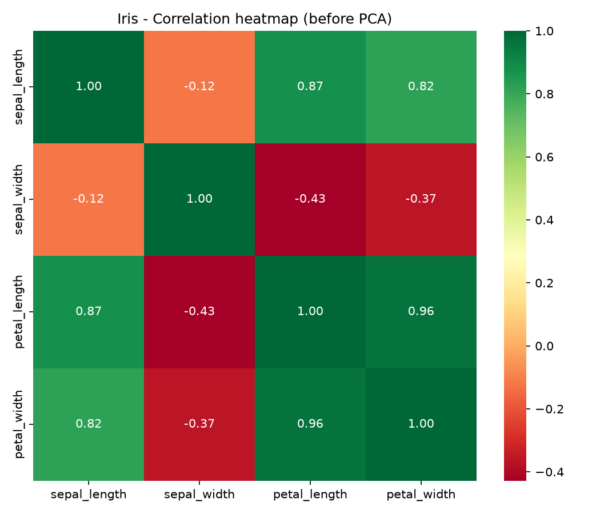
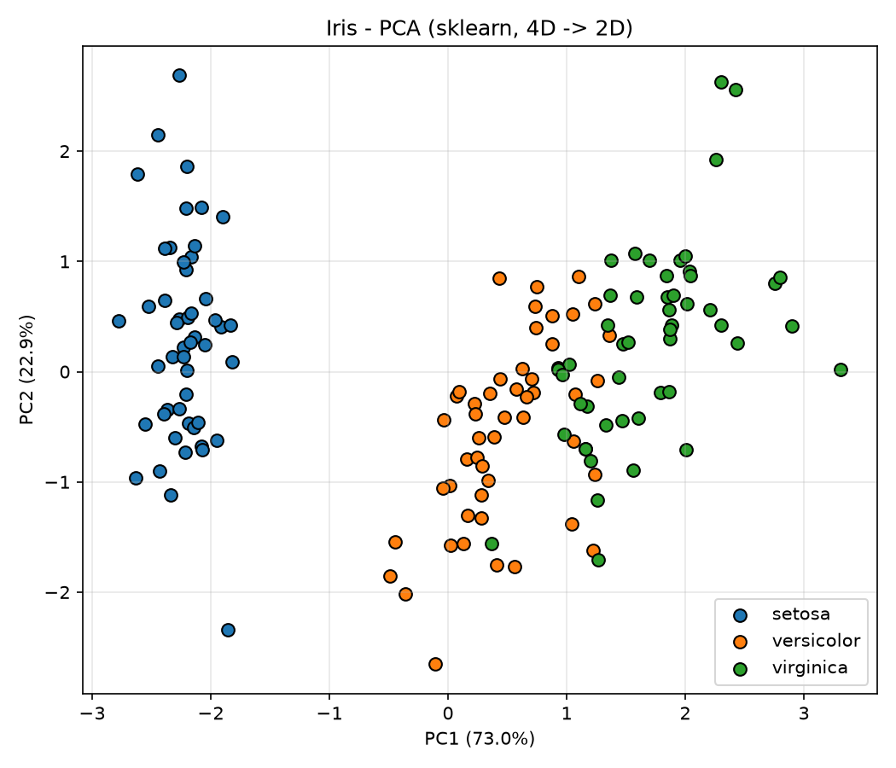
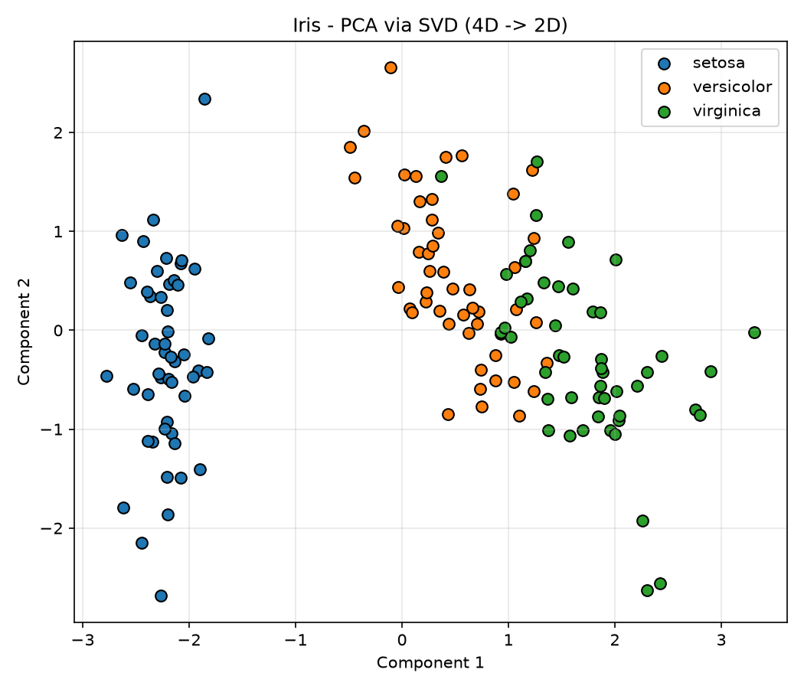
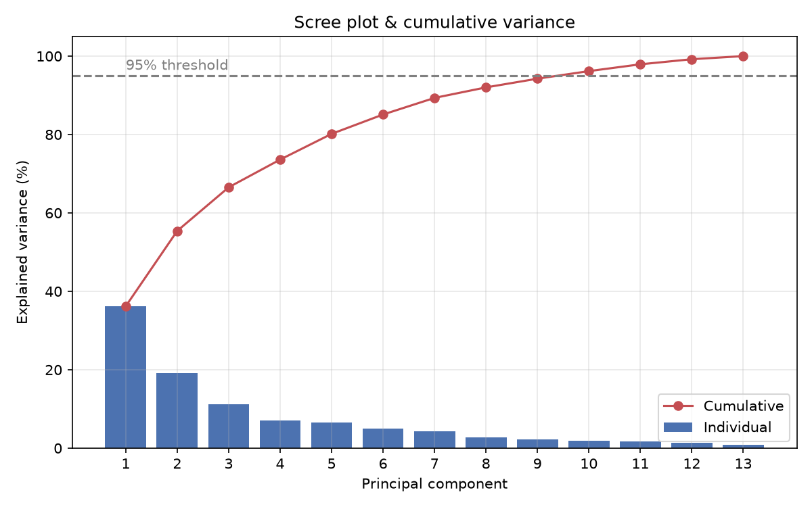
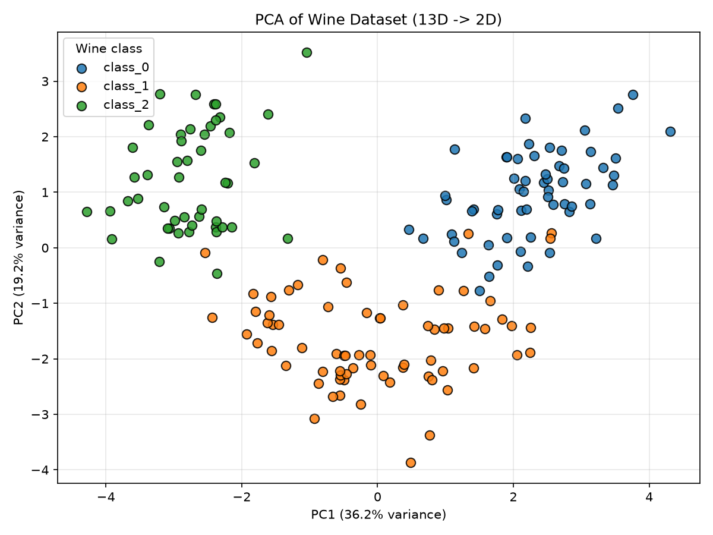
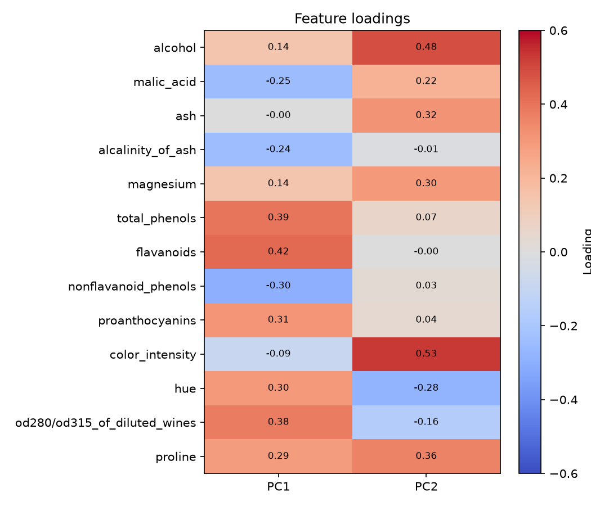

# 🤖 Machine Learning Lab — IIT Patna


A collection of my **Machine Learning Lab assignments and practice implementations** from IIT Patna. The focus is to understand each algorithm by implementing it **from scratch in Python**, and then cross-checking the result against the standard library implementation (scikit-learn / SciPy).

> **Author:** Aman Kumar · B.S. Computer Science & Data Analytics, IIT Patna (2025–2029)

---

## 📑 Table of Contents
1. [Repository Structure](#-repository-structure)
2. [Chapter Overview](#-chapter-overview)
3. [Chapter Details](#-chapter-details)
4. [Chapter 06 — PCA in Depth](#-chapter-06--pca-in-depth)
5. [Getting Started](#-getting-started)
6. [Tech Stack](#-tech-stack)
7. [Learning Outcomes](#-learning-outcomes)
8. [Connect](#-connect)

---

## 📂 Repository Structure

```
Machine_Learning_Lab/
├── Chapter_01_KNN/
├── Chapter_02_Naive_Bayes/
├── Chapter_03_Performance_Metrics/
├── Chapter_04_Decision_Trees/
├── Chapter_05_Linear_Regression/
├── Chapter_06_PCA/
│   ├── 1_PCA_Iris_From_Scratch.py
│   ├── 2_PCA_Iris_Inbuilt_Function.py
│   ├── 3_SVD_Iris_Inbuilt_Function.py
│   ├── 4_Assignment5_PCA_Wine.py
│   ├── output_iris_sklearn.txt
│   ├── output_iris_svd.txt
│   ├── output_wine.txt
│   ├── requirements.txt
│   └── images/
└── README.md
```

---

## 📚 Chapter Overview

| # | Chapter | Type | Core Idea |
|---|---------|------|-----------|
| 01 | [K-Nearest Neighbors](./Chapter_01_KNN) | Supervised · Classification | Classify a point by the majority label of its *k* closest neighbours |
| 02 | [Naive Bayes](./Chapter_02_Naive_Bayes) | Supervised · Classification | Bayes' theorem with a feature-independence assumption |
| 03 | [Performance Metrics](./Chapter_03_Performance_Metrics) | Evaluation | Confusion matrix, accuracy, precision, recall, F1 |
| 04 | [Decision Trees](./Chapter_04_Decision_Trees) | Supervised · Classification | Recursive splits chosen by entropy / information gain or Gini |
| 05 | [Linear Regression](./Chapter_05_Linear_Regression) | Supervised · Regression | Fit a linear relationship by minimizing squared error |
| 06 | [Principal Component Analysis](./Chapter_06_PCA) | Unsupervised · Dimensionality Reduction | Project data onto directions of maximum variance |

---

## 📖 Chapter Details

### Chapter 01 — K-Nearest Neighbors (KNN)
Instance-based learning: no training phase, prediction is made by measuring distance (e.g. Euclidean) to all training points and voting among the *k* nearest. Key ideas: choice of *k*, distance metrics, feature scaling.

### Chapter 02 — Naive Bayes
Probabilistic classifier based on Bayes' theorem, `P(C|X) ∝ P(C) · ∏ P(xᵢ|C)`. Includes a Gaussian Naive Bayes implementation on the Iris dataset.

### Chapter 03 — Performance Metrics
How to judge a classifier beyond accuracy: confusion matrix, precision, recall, F1-score, and when each one matters (e.g. imbalanced data).

### Chapter 04 — Decision Trees
Tree-based classifier that splits data on the feature giving the best impurity reduction (entropy / information gain or Gini index). Covers overfitting and tree depth.

### Chapter 05 — Linear Regression
Predicting a continuous target (e.g. house price from multiple features) by fitting a line/hyperplane that minimizes the mean squared error.

### Chapter 06 — Principal Component Analysis (PCA)
Dimensionality reduction by projecting standardized data onto the top eigenvectors of the covariance matrix. Implemented three ways (from scratch, scikit-learn, SVD) on **Iris**, plus **Assignment 5** on the **Wine** dataset. See the next section.

---

## 🔬 Chapter 06 — PCA in Depth

### Files

| File | Description |
|---|---|
| `1_PCA_Iris_From_Scratch.py` | Covariance matrix → eigenvalues/eigenvectors → sort → project (NumPy only) |
| `2_PCA_Iris_Inbuilt_Function.py` | `sklearn.decomposition.PCA(n_components=2)` |
| `3_SVD_Iris_Inbuilt_Function.py` | `scipy.linalg.svd`, projection `U·Σ` |
| `4_Assignment5_PCA_Wine.py` | **Assignment 5**: PCA on Wine (13 → 2 features) |

### Algorithm (all 3 methods)
1. Load data and separate features `X` and labels `Y`
2. **Standardize** features (mean 0, std 1) with `StandardScaler`
3. Find principal directions
   - From scratch: eigen-decomposition of `np.cov(X)`
   - sklearn: `PCA.fit_transform`
   - SVD: `X = U Σ Vᵀ`, where eigenvalue = `σ² / (n−1)`
4. Explained variance ratio = `λᵢ / Σλ`
5. Project data onto the top-k components and visualize

### Part A — Iris (4D → 2D)



| Component | Explained variance | Cumulative |
|---|---|---|
| PC1 | 72.96 % | 72.96 % |
| PC2 | 22.85 % | **95.81 %** |
| PC3 | 3.67 % | 99.48 % |
| PC4 | 0.52 % | 100 % |

| sklearn PCA | SVD |
|---|---|
|  |  |

Both methods give the same projection (up to sign). Setosa is fully separated; versicolor and virginica overlap slightly.

### Part B — Assignment 5: Wine dataset (13D → 2D)

**Problem:** Apply PCA to the Wine dataset (178 samples, 13 features, 3 classes), keep 2 components, report variance, visualize the classes and discuss information loss.

| Task | Solution |
|---|---|
| 1–2 | `load_wine()`, split `X` and `y` |
| 3 | `StandardScaler` on all 13 features |
| 4 | `PCA(n_components=2)` |
| 5 | Explained variance: PC1 **36.20 %**, PC2 **19.21 %**, cumulative **55.41 %** |
| 6 | Scatter plot, 3 classes in 3 colours |
| 7 | Original vs reduced comparison, reconstruction error, information-loss discussion |





The three cultivars form clearly separated clusters; only class 0 and class 1 overlap slightly.

**What the components mean**



- **PC1** ≈ "phenolic content" axis (`flavanoids`, `total_phenols`, `od280/od315`, `proanthocyanins`; `nonflavanoid_phenols` negative)
- **PC2** ≈ "colour / alcohol strength" axis (`color_intensity`, `alcohol`, `proline`; `hue` negative)

**Information lost**

| | Original | Reduced |
|---|---|---|
| Shape | 178 × 13 | 178 × 2 |
| Variance | 100 % | 55.41 % |
| Reconstruction MSE (standardized) | 0 | 0.446 |


- **44.59 %** of the variance is discarded. `ash`, `alcalinity_of_ash` and `magnesium` are reconstructed worst; `flavanoids` best.
- Despite this, class structure survives: Logistic Regression (5-fold CV) scores **98.9 %** on all 13 features vs **95.5 %** on only 2 components, a ~3-point drop for an ~85 % reduction in dimensions.
- 8 components keep ≥ 90 % of the variance and 10 keep ≥ 95 %, so 2 components are good for visualization but not lossless.
- Limitations: components are harder to interpret, PCA is linear, and it is unsupervised (it maximizes variance, not class separation).

### Key takeaways
- Always **standardize** before PCA when features have different scales.
- SVD equals PCA only when the data is **centered**.
- The right number of components depends on the data: Iris needs 2 (95.8 %), Wine needs far more.

---

## 🚀 Getting Started

```bash
# 1. Clone
git clone https://github.com/AmanBhardwazzz17/Machine_Learning_Lab.git
cd Machine_Learning_Lab

# 2. (Optional) virtual environment
python -m venv .venv
source .venv/bin/activate        # Windows: .venv\Scripts\activate

# 3. Install dependencies
pip install numpy pandas scipy scikit-learn matplotlib seaborn

# 4. Run any script
python Chapter_06_PCA/4_Assignment5_PCA_Wine.py
```

Plots are saved automatically to each chapter's `images/` folder.

---

## 🛠 Tech Stack
**Python** · NumPy · pandas · SciPy · scikit-learn · Matplotlib · Seaborn · VS Code

---

## 🎯 Learning Outcomes
- Implement core ML algorithms from first principles and validate them against library versions
- Evaluate models with the right metrics instead of accuracy alone
- Understand the bias/variance and dimensionality trade-offs
- Present results with clean visualizations and clear written analysis

---

## 🤝 Connect
- GitHub: [AmanBhardwazzz17](https://github.com/AmanBhardwazzz17)
- Linktree: [linktr.ee/Amann_Bhardwaz](https://linktr.ee/Amann_Bhardwaz)

⭐ If this repository helped you, consider giving it a star.